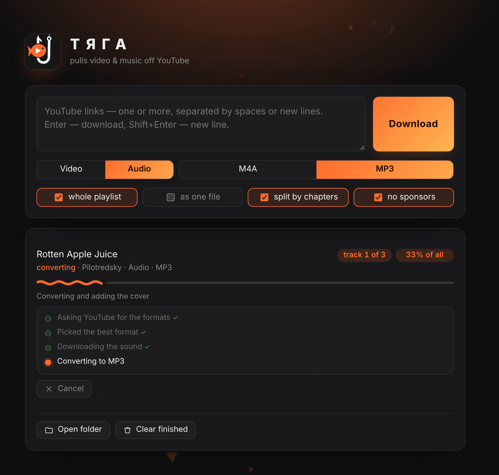

<p align="center">
  
</p>

<h1 align="center">ТЯГА</h1>

<p align="center">
  <b>Paste a YouTube link, get a file.</b><br>
  <a href="../../releases/latest"></a>
  <a href="../../actions/workflows/ci.yml"></a>
  
</p>

ТЯГА downloads video and music from YouTube. Paste links any way you like, pick video or audio, and get clean files with proper tags and real album covers. It's one small portable program for Windows: nothing to install, nothing left behind. The downloading itself is done by [yt-dlp](https://github.com/yt-dlp/yt-dlp).

<p align="center">
  
</p>

## Get started

1. Download the zip from [Releases](../../releases/latest) (`windows-amd64` for most PCs, `windows-arm64` for ARM laptops) and unpack it into a folder of your own: Desktop, Documents, another drive, not Program Files.
2. Run `tyaga.exe`. If Windows says "Windows protected your PC", choose "More info" → "Run anyway": the program isn't signed, which is usual for small projects.
3. Paste links, press **Download**. Music goes to your **Music** folder, video to **Videos**.

On the first start ТЯГА fetches yt-dlp, ffmpeg and Deno from their official GitHub pages (about 250 MB, once), checks each against its published checksum, and keeps them next to itself.

## What it does

- **Any paste works.** Several links at once, a chat message with links in it, links without `https://`, the same video twice: ТЯГА finds every link, cleans it and adds each video once.
- **A preview first.** Each link shows its picture and title at once, then what's in it: length, chapters, the qualities there are, ads that can be cut.
- **Video:** MP4 at the best quality or capped at a height you pick. "For editing" (the clapperboard) gives H.264 + AAC, which opens in DaVinci Resolve and any editor.
- **Music:** the original track (M4A) or MP3, clean tags, and the cover of the album the track is really from (the Apple Music catalogue), not of a compilation that has the same song.
- **Albums** uploaded as one long video are split into tracks by chapters.
- **Playlists and channels** go into a folder of their own, numbered, or into one file with a chapter per video. A deleted or private video is skipped, and Retry fetches only what's missing.
- **Fragment:** download only a piece of a video: drag the ends on a slider or pick chapters. A link with `?t=` starts where the link does.
- **No sponsors:** SponsorBlock cuts the ads and the "don't forget to subscribe" bits.
- **Clear progress:** one row per download, with its picture, "17 MB of 45 MB · 3.5 MB/s · 0:05 left", and ТЯГА's fish swimming along a line. The taskbar button shows it too.
- **Nothing lost:** what was still downloading when ТЯГА closed is back in the list next time, and resumes. A file that's already there isn't downloaded again.
- **Into a chat in one go:** copy a finished file with one click and paste it into Telegram or any chat with Ctrl+V.
- **Sign in to YouTube** for videos that need it: one click on the badge by the logo. The sign-in is read from the browser you use.

## Good to know

- **Where files go.** Music to Windows' Music folder, video to Videos (wherever Windows keeps them, OneDrive included). The folder button picks another folder; "Music and Videos" in its menu goes back.
- **Portable.** Everything ТЯГА keeps (its tools, their caches, settings, sign-in, the log) is in one hidden `tyaga-data` folder next to `tyaga.exe`. Nothing goes to AppData or the registry. Delete the folder and ТЯГА is gone.
- **Closing.** × hides ТЯГА to the tray and downloads go on. Quit is in the tray icon's menu.
- **Light and dark, English and Russian.** The theme follows Windows until you pick one; the globe button switches the language.
- **Cookies by hand** work too: save them as `youtube-cookies.txt` next to the program. They are the keys to your account: never share or commit them.
- **Something went wrong?** `tyaga-data\tyaga.log` says what happened.

## Privacy and security

ТЯГА talks only to what it needs: YouTube (through yt-dlp, and its public oEmbed for a preview's title), GitHub (the tools and their updates, checked by checksum), Apple's iTunes Search API (album covers), SponsorBlock (ad segments). No accounts, no analytics, nothing sent anywhere else.

The window is a page served by ТЯГА itself, on `127.0.0.1` only, behind a random token that other programs and websites don't know. yt-dlp runs with its own configuration and plugins ignored, and a link can't be taken for an option. Only sound and video files are opened by a double-click.

## Development

You need Windows 10 or 11, [Git](https://git-scm.com/) and [Go](https://go.dev/dl/) 1.26 or newer. [VS Code](https://code.visualstudio.com/) with the Go extension is the easy way.

```powershell
git clone https://github.com/nadludyna/tyaga.git
cd tyaga
go run .
```

`go run .` opens ТЯГА's window straight from the source; its `tyaga-data` folder is made in the project folder (and ignored by Git). Change `index.html`, run it again, see the change.

To build the exe as the releases do:

```powershell
$env:CGO_ENABLED = "0"; go build -tags production -trimpath -ldflags "-s -w -H=windowsgui" -o tyaga.exe .
```

### Checks

- `go test ./...`: the Go tests (some need ffmpeg in PATH). `TYAGA_LIVE=1 go test -run Live -v` also asks the real YouTube, GitHub and Apple.
- **The test stand** (`stand/README.md`): the real program against a fake yt-dlp that prints what the real one does, so every state can be seen without YouTube. On it:
  - `stand/check.js` measures the page in every state for anything misaligned, cut off, overlapping or moving;
  - `stand/scenarios.js` uses it the way people do (a chat message pasted, ten links, cancel, a failure, a playlist, the fishing line frame by frame) and checks what happens;
  - `stand/snapshot.js` takes every state as a picture and compares two runs pixel by pixel: for a change that must not change how anything looks.
- **CI** runs all of it on every pull request: `gofmt`, `go vet`, the Go tests, a Windows build, the page's scripts, the layout checks in both themes, both languages, wide and narrow, and the scenarios.

### Releases

Actions → **Release** → a version like `v2.1.0`. It builds `tyaga.exe` for Windows x64 and ARM64 and publishes each as a zip.

### Where things are

| | |
|---|---|
| `main.go` | the local server and its API |
| `jobs.go` | the queue, yt-dlp's command line, reading its output |
| `inspect.go` | looking a link up before downloading |
| `tools.go`, `ytdlp_unpacked.go` | getting yt-dlp, ffmpeg and Deno, and keeping them up to date |
| `cover.go`, `merge.go` | album covers; a playlist glued into one file |
| `queue.go`, `data.go` | what survives a restart; the `tyaga-data` folder |
| `window_windows.go` | the window, the tray icon and its menu |
| `index.html`, `menu.html` | the whole page; the tray menu |
| `stand/` | the test stand |
| `CLAUDE.md` | the rules and checks for anyone (or any AI agent) changing the code |
| `docs/` | how the page should behave (`ui-principles.md`), and why things are the way they are (`decisions.md`) |

## The name

**ТЯГА** (say *TYA-ga*; the file is `tyaga`) is Russian and Ukrainian for *pull*, *traction*, from *тянуть*, "to pull"; pulling a file down off the internet is *стянуть*. The icon says the same: a hook that caught a fat fish with a play button on its side.

## License

[MIT](LICENSE). yt-dlp, ffmpeg and Deno are separate projects with their own licenses; ТЯГА doesn't ship them, it fetches them from their official pages.
